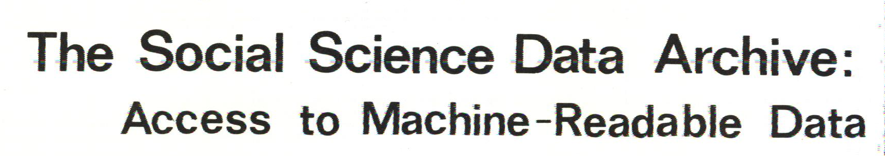
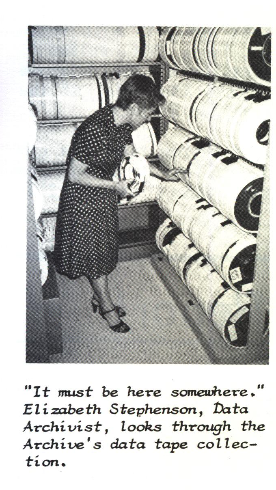
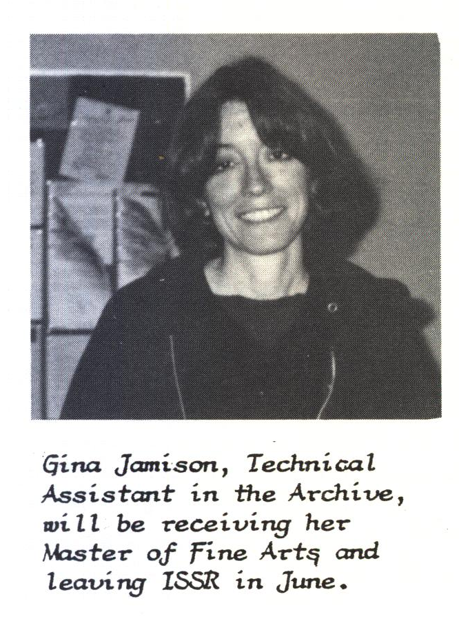
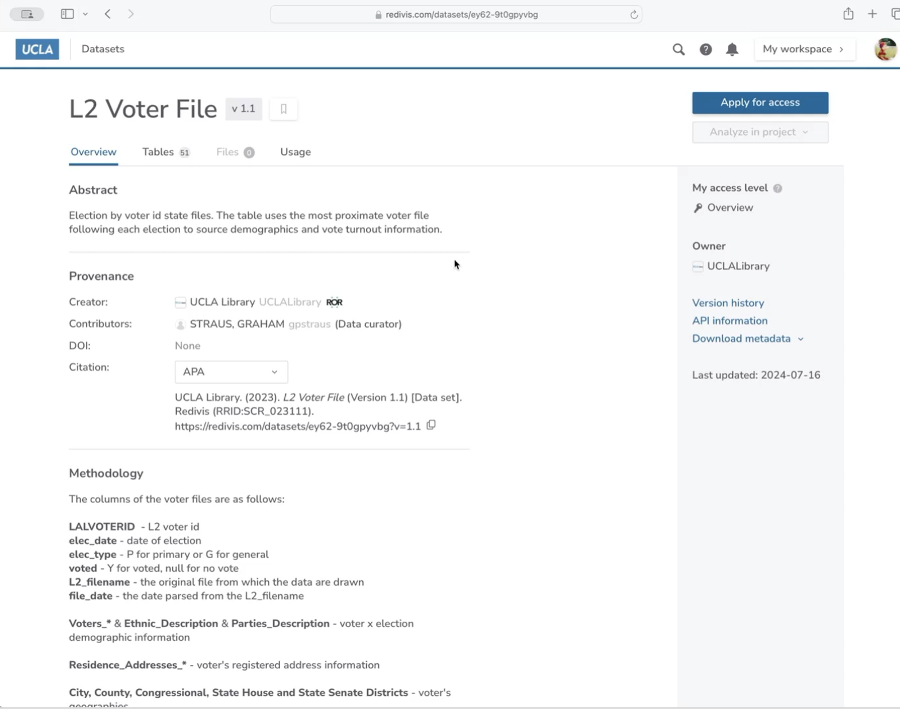
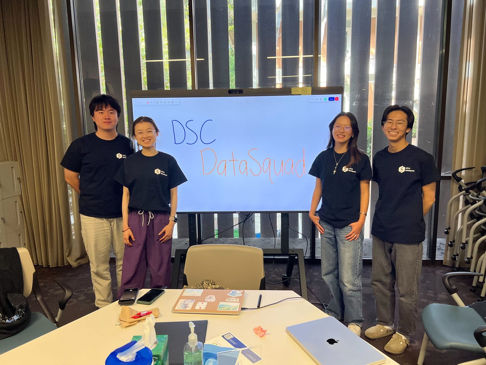
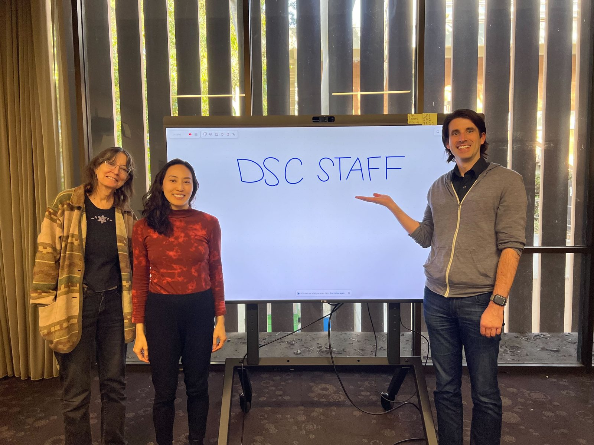

::: {.callout-note}
This is the October 2026 version, written from public sources and the author's records. Where a point rests on the author's own account, the text says so. Corrections are welcome through the "Report a correction" link in the footer.
:::

## The history in 30 seconds

UCLA has kept research data for other researchers to use since **1961**, when political
scientist Dwaine Marvick started the Political Behavior Archive to share survey data on campus.
In 1977 the Institute for Social Science Research named that collection the Social Science Data
Archive and gave it staff who helped researchers use it. In 2014 the archive moved to the UCLA
Library, and in 2018 it became the core of the Library's Data Science Center, open to every
discipline. On August 24, 2026, the Library dissolved the Center as a unit and moved its staff into Research Services.[^reorg] The material changed along the way, from punch cards and survey tapes to restricted
national datasets, aerial imagery, 3D scans, and scanned pages turned into data. The
responsibility for keeping data usable continued: keep that evidence findable, usable, and
trustworthy for the next person.

## About this account

Tim Dennis, the author, directed the archive and then the Data Science Center from 2017 through
2026, so the recent chapters are a participant's account. They are held to cited records where
those exist, and the notes say where a claim rests on the author's own account; the full statement is under [The author's position](#the-authors-position). A
[companion document](history-companion.html) holds the full roster, project inventories, chart
methods, and open questions.

## What persisted, what changed, and why it matters

### What persisted: someone answerable for the data

Since 1961 someone at UCLA has been responsible for research data after the study that produced
it ended: taking it in, describing it so a stranger could use it, deciding who may see it, and
keeping it readable when the technology underneath changed. Five institutional homes held that
responsibility in turn: a faculty archive, a survey center, a research institute, a standalone
archive in the Social Sciences division, and the Library.

Four kinds of things had to travel with it through each move.

- The collections and their documentation. The Los Angeles surveys of the 1970s through the
  2000s, with their codebooks (the documentation that says what each question and code means),
  went from tape to Harvard's Dataverse and are searchable today through UCLA's own repository.
- The relationships. UCLA was a founding member in 1962 of ICPSR, the national social science
  data consortium based at the University of Michigan, and the archive still held the ICPSR and
  Roper Center subscriptions for the campus when it moved to the Library in 2014. Depositors,
  faculty users, and data vendors dealt with the archive, whatever office it reported to.
- The working knowledge. How a dataset was built, what its license allows, what a variable meant
  in 1974. Much of that lived in people. Jamie Jamison is named in an archive newsletter from
  about 1979 and still runs the repository.
- The obligations. Data-use agreements, preservation commitments, and the 2014 transfer
  agreement's provision that if there are substantial changes to the archive's operations within
  the Library, the Library and the Social Sciences Division "should meet to discuss and ensure
  the continuation of College faculty's access to the services provided by Social Sciences Data
  Archives."

### What changed: the homes, the users, and above all the material

The archive changed homes four times. It began as a service for social scientists, had
become the campus's de facto data service by the 1990s, and after 2018 served any discipline. The material changed most. Survey files needed codebooks and a reference room.
Restricted national data needed a governed computing environment. Point clouds needed a viewer
that runs in a browser. Handwritten tables needed OCR before they could be analyzed at all. Each
new kind of material asked the same stewardship questions, and the older tools could not answer
them.

### Why it matters: data stays usable only while someone is accountable for it

A restricted dataset can be used only while its agreement is administered. A repository stays
citable only while its identifiers resolve and its software is patched. A scanned collection
stays readable only while someone knows how its text was produced. In every transition below,
those duties were carried by specific people with specific budgets and systems. Some were nearly
dropped: around 1980 the Library declined the 1980 census tapes and the archive took them on,
and after 2024 the campus ArcGIS platform was left without an assigned administrator. When
stewardship changes hands, the collections, agreements, systems, and working knowledge have to
move together. Otherwise the files may survive without the context that made them usable.

## Two tracks: where the archive lived, and what it stewarded

The top track shows where the archive sat; the bottom track shows dated examples of what it
stewarded or offered. Gaps on the bottom track are periods without a firm date, not periods
without work.

::: {.content-visible when-format="pdf"}
| Years | Institutional home | Dated material or service |
|------|-----------|-----------|
| 1961–1964 | Political Behavior Archive (Marvick) | 1961: survey and behavioral data distributed to UCLA researchers |
| 1964–1974 | Survey Research Center, Archival Data Library | 1970–1976: LAMAS survey waves |
| 1974–c. 2009 | Institute for Social Science Research (SSDA named 1977; the date the archive came under ISSR is uncertain) | 1977: a named, staffed consulting service; 1992–2002: LACSS surveys |
| c. 2009–2011 | Institute for Social Research | |
| c. 2011–2014 | Standalone SSDA, Social Sciences | 2013: DDI-Lifecycle metadata tests |
| 2014– | UCLA Library (Data Science Center from 2018) | 2018: UCLA Dataverse; 2022: web 3D viewer (pointcloud.ucla.edu); 2023: governed restricted-data service (Redivis) |

*1974 and 1977 are separate events: ISSR (the parent institute) and the naming of the archive
unit within it are three years apart. Dated by the sources cited in each section below.*
:::

::: {.content-visible when-format="html"}
```{=html}
<figure class="viz-root ssda-timeline">
<style>
.ssda-timeline {
  color-scheme: light;
  --surface-1:      #fcfcfb;
  --text-primary:   #0b0b0b;
  --text-secondary: #52514e;
  --text-muted:     #6b6a65;
  --baseline:       #c3c2b7;
  --series-1:       #2774AE;
  --series-2:       #8BB8E8;
  font-family: inherit;
  background: var(--surface-1);
  padding: 16px 16px 12px;
  border-radius: 8px;
  overflow-x: auto;
  margin: 1rem 0 1.5rem;
}
body.quarto-dark .ssda-timeline {
  color-scheme: dark;
  --surface-1:      #1a2633;
  --text-primary:   #ffffff;
  --text-secondary: #c3c2b7;
  --text-muted:     #a9a79f;
  --baseline:       #4a5561;
  --series-1:       #8BB8E8;
  --series-2:       #3d6f9c;
}
.ssda-timeline svg { display: block; width: 100%; min-width: 560px; height: auto; }
.ssda-timeline .tl-track { font-size: 11px; fill: var(--text-muted); font-weight: 600; letter-spacing: 0.04em; text-transform: uppercase; }
.ssda-timeline .tl-home { font-size: 12px; fill: var(--text-primary); font-weight: 600; }
.ssda-timeline .tl-home-inv { font-size: 12px; fill: #ffffff; font-weight: 600; }
.ssda-timeline .tl-home-on-light { font-size: 12px; fill: #0b2033; font-weight: 600; }
.ssda-timeline .tl-year { font-size: 11px; fill: var(--text-muted); }
.ssda-timeline .tl-item { font-size: 12px; fill: var(--text-secondary); }
.ssda-timeline figcaption { font-size: 12px; color: var(--text-muted); margin-top: 8px; max-width: 660px; }
</style>
<svg viewBox="0 0 700 300" role="img" aria-labelledby="tl-title tl-desc">
  <title id="tl-title">Two tracks, 1961 to 2026: institutional home, and dated material or services</title>
  <desc id="tl-desc">Top track: Political Behavior Archive (PBA) 1961 to 1964; Survey Research Center (SRC) 1964 to 1974; Institute for Social Science Research, established 1974 (the date the archive came under it is uncertain, possibly 1976), to about 2009, with the archive named SSDA in 1977; Institute for Social Research about 2009 to 2011; standalone SSDA about 2011 to 2014; UCLA Library from 2014, as the Data Science Center from 2018. Bottom track: 1961 survey data distributed on campus; LAMAS surveys 1970 to 1976; 1977 staffed consulting service; LACSS surveys 1992 to 2002; 2013 DDI-Lifecycle metadata tests; 2018 UCLA Dataverse; 2022 web 3D viewer; 2023 governed restricted-data service.</desc>
  <text x="40" y="18" class="tl-track">Institutional home</text>
  <rect x="40"    y="44" width="28.6"  height="28" fill="#cfe0f0"/>
  <rect x="68.6"  y="44" width="95.4"  height="28" fill="#2774AE"/>
  <rect x="164"   y="44" width="333.8" height="28" fill="#cfe0f0"/>
  <rect x="497.8" y="44" width="19.1"  height="28" fill="#2774AE"/>
  <rect x="516.9" y="44" width="28.6"  height="28" fill="#cfe0f0"/>
  <rect x="545.5" y="44" width="114.5" height="28" fill="#2774AE"/>
  <line x1="583.7" y1="44" x2="583.7" y2="72" stroke="var(--surface-1)" stroke-width="2"/>
  <line x1="192.6" y1="44" x2="192.6" y2="72" stroke="var(--surface-1)" stroke-width="2"/>
  <text x="54"    y="38" class="tl-home" text-anchor="middle">PBA</text>
  <text x="116"   y="62" class="tl-home-inv" text-anchor="middle">SRC</text>
  <text x="345"   y="62" class="tl-home-on-light" text-anchor="middle">Institute for Social Science Research</text>
  <text x="196"   y="88" class="tl-year" text-anchor="start">1977: named SSDA, staffed</text>
  <text x="507"   y="38" class="tl-home" text-anchor="end">ISR, then standalone SSDA</text>
  <text x="552"   y="38" class="tl-home" text-anchor="start">UCLA Library</text>
  <text x="587"   y="88" class="tl-year" text-anchor="start">2018: DSC</text>
  <line x1="40" y1="150" x2="660" y2="150" stroke="var(--baseline)" stroke-width="1"/>
  <text x="40"    y="140" class="tl-year" text-anchor="middle">1961</text>
  <text x="164"   y="140" class="tl-year" text-anchor="middle">1974</text>
  <text x="316.6" y="140" class="tl-year" text-anchor="middle">1990</text>
  <text x="411.9" y="140" class="tl-year" text-anchor="middle">2000</text>
  <text x="545.5" y="140" class="tl-year" text-anchor="middle">2014</text>
  <text x="660"   y="140" class="tl-year" text-anchor="middle">2026</text>
  <text x="40" y="178" class="tl-track">Dated material or service</text>
  <circle cx="40" cy="200" r="5" fill="var(--series-1)"/>
  <text x="40" y="222" class="tl-item" text-anchor="start">1961 survey data</text>
  <text x="40" y="236" class="tl-item" text-anchor="start">shared on campus</text>
  <rect x="125.8" y="196" width="57.3" height="8" rx="4" fill="var(--series-1)"/>
  <text x="154.5" y="252" class="tl-item" text-anchor="middle">LAMAS 1970–76</text>
  <circle cx="192.6" cy="200" r="5" fill="var(--series-1)"/>
  <text x="200" y="222" class="tl-item" text-anchor="start">1977 staffed</text>
  <text x="200" y="236" class="tl-item" text-anchor="start">consulting service</text>
  <rect x="335.7" y="196" width="95.4" height="8" rx="4" fill="var(--series-1)"/>
  <text x="383.4" y="222" class="tl-item" text-anchor="middle">LACSS 1992–2002</text>
  <circle cx="536" cy="200" r="5" fill="var(--series-1)"/>
  <text x="530" y="252" class="tl-item" text-anchor="end">2013 DDI metadata tests</text>
  <line x1="536" y1="205" x2="536" y2="242" stroke="var(--baseline)" stroke-width="1"/>
  <circle cx="583.7" cy="200" r="5" fill="var(--series-1)"/>
  <text x="578" y="272" class="tl-item" text-anchor="end">2018 UCLA Dataverse</text>
  <line x1="583.7" y1="205" x2="583.7" y2="262" stroke="var(--baseline)" stroke-width="1"/>
  <circle cx="621.8" cy="200" r="5" fill="var(--series-1)"/>
  <text x="660" y="222" class="tl-item" text-anchor="end">2022 web 3D viewer</text>
  <circle cx="631.4" cy="200" r="5" fill="var(--series-1)"/>
  <text x="660" y="292" class="tl-item" text-anchor="end">2023 governed restricted data</text>
  <line x1="631.4" y1="205" x2="631.4" y2="282" stroke="var(--baseline)" stroke-width="1"/>
</svg>
<figcaption>Institutional homes (top) and dated examples of material or services (bottom), 1961–2026. Only firmly dated items are plotted; the empty stretches of the lower track are undated, not idle. ISSR (1974) and the naming of SSDA within it (1977) are three years apart. Dates are sourced in the sections below.</figcaption>
</figure>
```
:::

## 1961-1964: A political scientist starts a survey data archive

Political scientist Dwaine Marvick joined UCLA's political science faculty in 1954 [@marvickInMemoriam]
and founded the Political Behavior Archive (PBA) in 1961 [@stilesStephenson2008]. Rice and Southall place the archive in the field's
early cohort: in their table of social-science data libraries and centers, UCLA's service dates to 1961, ahead of
ICPSR itself (1962) [@riceSouthall2016].[^rice-table] The PBA distributed survey and behavioral data from ICPR (ICPSR's original name), the
Roper Public Opinion Research Center, and local holdings to UCLA researchers
[@stilesStephenson2008]. A UC memorial calls Marvick "one of the first advocates and practitioners of
computer applications to political data." No source found so far says why he founded the archive
in 1961 in particular, and Heinz Eulau's detailed 1999 memorial of Marvick never mentions it.[^eulau]

The next year UCLA was among the founding member institutions of ICPSR. That is confirmed
against the primary document: Warren Miller's August 1962 memo to Rensis Likert lists
"University of California at Los Angeles" among the members "as of July 30, 1962."[^miller-memo]
Two details often attached to it are shakier. The archive's own account says there were eight
founding members and that UCLA joined "through [Marvick's] efforts," but Miller's memo lists 21
institutions, and no document found so far gives Marvick a formal role in the founding. His
documented ICPSR service begins on its governing board in 1964. The reasoning is in the
companion's [open discrepancies](history-companion.html#open-discrepancies).


[^rice-table]: The table lists Roper (1957), Berkeley (1958), and GESIS (1960) before UCLA. It mixes data
libraries and data centers, and some dates may mark a different milestone than founding: the Roper Center
gives 1947 as its own founding year, and the German date belongs to the Central Archive, not to today's GESIS. This history therefore
says "early cohort" and does not rank UCLA.

[^miller-memo]: Warren E. Miller, memo to Rensis Likert, August 1962, listing member institutions as of July 30, 1962, a primary document rather than a later
description of it. Cross-checked against Erik Austin's ICPSR founding-members list. The "8 members" and
"through his efforts" phrasing is from the SSDA collection's "About" page on Harvard's
Dataverse, written by Stephenson.

[^eulau]: Heinz Eulau, "Good-bye to Two Dear Friends: Warren Miller and Dwaine Marvick, A
Personal Memoir," 1999.


## 1964-1974: The archive becomes a reference room in a survey center

The archive's next home was UCLA's Survey Research Center (SRC), formed in 1964, which housed an
"Archival Data Library" into which the PBA merged [@stilesStephenson2008]. Marvick's August 1967
proposal, *"Plans for the Development of a Social Science Archival Data Library in the UCLA
Survey Research Center"* [@marvick1967proposal], set out his plan for that library in writing.
The proposal is known from Stiles and Stephenson's citation; the document itself has not turned
up yet.

The archive work was already a formal part of the SRC: taking in datasets from the tape-sharing
era, keeping their codebooks, and running a reference room where researchers could work out how
to use machine-readable data. What did not exist yet was a named unit with its own staff and
consulting services. Stiles and Stephenson say the Archival Data Library ran "on a
reference-room basis only." One detail is unresolved: the archive's own account puts the 1964
SRC "under the direction of Eve Fielder," but her obituary says she became its first director in
1976.[^fielder]

The SRC's main data product in this decade was the Los Angeles Metropolitan Area Surveys
(LAMAS): ten waves, 1970–1976, a shared omnibus survey run about twice a year with questions
submitted by different researchers [@stilesStephenson2008; @pawlockiStephenson1988].

The decade's clearest mark came from outside the archive. Around 1970 the UCLA Library's Public
Affairs Service, under Mary Ryan, bought 1970 census tapes from DUALabs. It was the Library's
first move into numeric data, and it was cited nationally as an early case of a library taking
on machine-readable data [@roweRyan1974; @dodd1982].

[^fielder]: The "1964, under Eve Fielder" claim comes from the archive's own Dataverse-page text,
written by Stephenson, and is repeated in 2017 internal presentations. The conflicting obituary
date turned up in a July 2026 research pass through published sources. See the companion's
[open discrepancies](history-companion.html#open-discrepancies).


## 1974-1977: ISSR names the archive and gives it staff

The Institute for Social Science Research (ISSR) was established in 1974 under founding
director Howard E. Freeman, a medical sociologist [@stilesStephenson2008]. The SRC and its
archival data library came under ISSR, but the date of that transfer is not settled: one
research pass puts it in 1976 (see the note on the 1977 date below). **In 1977** Associate Director Donald Treiman took the library that had
run "on a reference-room basis only," designed a research-support framework for it (working
alongside a project across its whole life cycle, still the archive's stated mission decades
later), and formalized it as a named service unit, the Social Science Data Archive (SSDA), with
its own Data Archivist line [@stilesStephenson2008; @pawlockiStephenson1988]. An OECD
international directory dates the "ISSR Data Archive at UCLA" to December 1977.[^issr-1977]

So 1977 is when the archive was named and staffed, not when it was founded. The work ran without
a break through the PBA and the SRC. Sources that seem to disagree about 1977 are describing
different parts of the same change; one open question is whether Treiman's unit reported to ISSR
directly or to the SRC within it (see the companion's
[open discrepancies](history-companion.html#open-discrepancies)).

[^issr-1977]: *Social Sciences for a Digital World* (OECD, 2000), an international directory that
dates the ISSR Data Archive at UCLA to December 1977. The same July 2026 research pass also
separates a 1976 step, the SRC being
taken into ISSR, from the December 1977 step, SSDA being formally established as a named unit.


## 1977-2014: The archive becomes a campus data service

From 1977 to 2014 the archive went through three arrangements.[^three-subperiods]

- ISSR proper, 1977 to the late 2000s. The archive was a service unit of the institute, whose
  directors were Howard E. Freeman (1974–1981), Marilynn B. Brewer (from about 1983 to 1993), and
  David O. Sears (1993–2008).
- The Institute for Social Research, about 2009 to 2011. The parent was renamed ISR, with the
  Data Archive still among its components.
- A standalone SSDA, about 2011 to 2014, listed on its own as a Social Sciences collection. No
  source records a formal dissolution of the parent institute, and the reporting line up to the
  2014 transfer is unresolved.

Around 1980 the flow ran the other way from the rest of this history. When the UCLA Library
decided not to buy the 1980 census tapes, ISSR and SSDA took them on, with the support and
storage that came with them [@stilesStephenson2008]. Numeric-data stewardship moved from the
Library to the archive, the reverse of what would happen in 2014.

The recurring survey work carried on throughout, renamed and reshaped: the Southern California
Social Survey (SCSS), then the Los Angeles County Social Survey (LACSS), which ran at least
1992–2002 (series detail in the companion's
[1977–2014 section](history-companion.html#detail-1977-2014)). By the 1990s the archive had
become, in its own staff's words, "the de facto campus-wide data service unit," serving public
health, education, policy studies, law, and management as well as the social science departments
[@stilesStephenson2008]. A surviving SSDA newsletter from about 1979 names Martin Pawlocki
(programmer), Gina Jamison (the same person as today's DSC staff member Jina "Jamie" Jamison), and
Shirley Lane, who had come from the UCLA Research Library's machine-readable 1970 Census project.[^newsletter]

{fig-alt="Newsletter masthead reading: The Social Science Data Archive: Access to Machine-Readable Data."}

::: {layout-ncol=2}
{fig-alt="Black-and-white photo of Elizabeth Stephenson holding a reel of magnetic tape beside racks of data tapes, with the newsletter's typed caption below."}

{fig-alt="Black-and-white portrait photo of Gina Jamison with the newsletter's typed caption saying she will receive her Master of Fine Arts and leave ISSR in June."}
:::

*From the archive's own newsletter, about 1979, as photographed for a 2017 Library staff presentation.*

Elizabeth "Libbie" Stephenson is the era's through-line. ICPSR's retirement profile dates her UCLA
start to about 1977, and she is documented as staff and later Director through the 2014 transfer,
retiring in 2016 [@pawlockiStephenson1988; @stephenson2013dodd; @dotyEtal2014].[^stephenson] Her
long run of work on bibliographic control, with Sue Dodd's scholarship, IASSIST, and ICPSR, was
early data-citation practice under an older name: making data properly identified and findable.
By 2013 SSDA was already testing DDI-Lifecycle, the international standard for describing
survey data across its life, and Colectica curation software. The archive also worked across borders on the Intergenerational
Stratification and Mobility File, built with Harry Ganzeboom of the Free University in Amsterdam
and Donald Treiman, and funded by the Netherlands Organisation for Scientific Research
[@stilesStephenson2008].

[^three-subperiods]: The three-subperiod structure rests on the digitized UCLA General Catalogs
(2003–05, 2005–07, 2009–10, 2010–11, 2011–12, 2013–14), read in a July 2026 research pass. Sears's 1993–2008 ISSR directorship is independently
confirmed. Freeman's and Brewer's exact terms, and the date of the ISSR-to-ISR rename, are still
soft; operational staff named in that pass are listed in the companion's
[roster](history-companion.html#roster).

[^newsletter]: Photographed excerpts of an SSDA newsletter from about 1979, embedded in a 2017
internal Library presentation. Jamie Jamison confirmed to Tim
directly that "Gina Jamison" is her.

[^stephenson]: ICPSR's own materials, including its retirement profile, put her retirement
in 2016 rather than 2014 and date her UCLA start to about 1977; Pawlocki and Stephenson's 1988
IASSIST article independently documents her as staff by 1986.


## 2014-2018: The archive moves to the Library and widens its mandate

**The 2014 transfer agreement** (effective 2014, executed 2015) moved SSDA from the Social
Sciences Division to the UCLA Library. It carried 2.0 FTE with about $245K in permanent funds covering the two positions' salary and
benefits, plus about $29K in separate permanent funds for subscriptions (ICPSR, Roper, UC
Berkeley/SDA, Colectica/Algenta). A separate,
small foundation gift fund came too: the Data Archive Purchase Fund (fund no. 604970/56972),
set up in the Social Sciences division to support the archive. Elizabeth Stephenson and Jina "Jamie" Jamison came across with it
[@uclaSsdaMou2014]. Its stated purpose was to "expand access to the archive's expertise while
modernizing its services." It also carried a consultation clause: if the Library later made
"substantial changes to the operations of Social Sciences Data Archives," it was to meet with the
Social Sciences Division and keep faculty access intact.

In April 2017 Tim Dennis was hired as Director of SSDA, succeeding Stephenson.[^tim-hire] That
November he presented "Library Data Archive" to UCLA Library staff, already framing 1961 to 2017
as one arc under the tagline "Providing archive and data services since 1961" [@dennis2017deck].
The team then reworked the unit's services through a design-thinking exercise that put "the user
as the scholar in need of research support" at the center [@dennisEtal2021]. In spring 2018 the
unit was restructured and renamed the Data Science Center (DSC), with a mission written to cover
any discipline,

> to foster a welcoming research community by developing data literacy and foundational coding
> skills through consulting and education … supporting researchers throughout the full data life
> cycle: planning and data management plans; acquisition, storage, cleaning and usage; analysis;
> publication; curation; and preservation [@dennisEtal2021].

SSDA became a named component of it. Todd Grappone, then the Library's AUL for Digital
Initiatives and IT, handled the 2014 transfer, coined the "Data Science Center" name, and helped
design the 2018 service model.[^grappone]

[^tim-hire]: Tim Dennis, personal account, 2026-08-09.

[^grappone]: Tim Dennis, personal account. Grappone's role in the 2014 transfer and the 2018
naming is not in any public source; it rests on the author's account as a participant. Grappone
became University Librarian at UC Santa Barbara in July 2025.


## 2018–2026: The Data Science Center takes on new kinds of research material

The new name widened the scope; the archive's work carried on under it. Staff grew
from 2.0 FTE (full-time equivalents) at the 2014 transfer to five by about 2021, mostly by
redesigning existing Library positions, while the repository, the teaching program, and the
kinds of material researchers brought all grew. This chapter follows three
changes: the material researchers brought, what DSC built to steward it, and the people and money
that kept it running. The author directed the unit throughout, so the chapter rests on cited
records; project inventories and career detail are in the companion's
[2018–present detail](history-companion.html#dsc-era-detail).

### Researchers arrived with material the survey archive was never built for

Survey files still came in. By the early 2020s researchers were also bringing national voter
files too large and too restricted to download, drone and aerial imagery, point clouds (millions
of measured 3D points that together model an object or a landscape), handwritten tables that no
standard text-recognition software could read, and research code with no license. Geography was
the largest single departmental audience for DSC workshops from 2020 to April 2024, and DSC ran the campus ArcGIS Online
mapping platform, which grew past 7,000 accounts. That ended when the unit's GIS librarian left for a
faculty position in August 2024; the position has not been filled.[^gis]

Four cases show how DSC handled that range. Each starts with a stewardship problem and ends with
what stayed usable.

[^gis]: GIS workshop and consultation figures and the ArcGIS account totals: DSC statistics and
Tim Dennis's Data Summary, 2023–2025, cross-checked against an OARC governance report (Dec 2025).
The fuller spatial-data account is in the companion's
[2018–present detail](history-companion.html#dsc-era-detail).

### The collections kept working, and the curation kept going, under a new name

The legacy SSDA collection lived on Harvard's hosted Dataverse, a widely used open-source
repository for research data, and the archive's policies, terms, and deposit practice were
written for a "Data Archive." Those policies and deposit procedures stayed in use after the
rename. The archive's policy repository, created in July 2017, was maintained through May 2020, two years after the new name,
and in 2018 DSC stood up a UCLA instance of Dataverse. It chose Dataverse for the reasons the
archive had chosen it before: support for DDI, the metadata standard for describing survey
data; the ability to restrict licensed files; and a range of curation from self-service deposit
to fully mediated. DSC connected it to UCLA single sign-on, to DOIs (the persistent identifiers
that make a dataset citable), and to preservation through the California Digital
Library.[@dennisEtal2021]

Rather than migrate the legacy collection immediately, DSC harvested it
into the new repository's search: keep it working first, move it later.
Jina "Jamie" Jamison, who came across with the archive in 2014, ran that repository day to day.
She wrote the preservation documentation, kept nightly database backups and a tested rebuild
script in place, and walked depositors through collections and DOIs.

By 2026 UCLA Dataverse held
about 1,390 released datasets: about 376 deposited directly at UCLA and about 1,014 harvested
from the legacy SSDA collection. Counting drafts and restricted deposits, the total is about
1,600.[^dataverse-count] Reuse is harder to count: some repository records link to related
publications, but those links are incomplete and cannot measure total reuse.

The curation continued too, though no longer under the SSDA name. DSC did not publish new studies
as the archive; it helped researchers prepare their own data for publication. A two-stage pattern settled in over time. A research group first worked its
dataset out and published it in UCLA Dataverse, with DSC helping shape it along the way. Once the data was stable, it could go to ICPSR, which has the staff to curate a
dataset down to the level of individual variables and document it for long-term reuse.[^curation]
The UCLA Law Behind Bars Data Project, which tracked COVID-19 in prisons, jails, and immigration
detention nationally, followed that path: its COVID Prison Policy Index went into UCLA Dataverse in
2022, and ICPSR released a curated version as study 38730 in 2023. Nicholas Shapiro's
Carceral Ecologies lab did the same with its autopsy analysis of deaths in the Los Angeles County
jail: published in UCLA Dataverse in May 2023, released by ICPSR as study 38958 in 2024. DSC
consultation records show both projects asking DSC about ICPSR deposit along the way, Carceral
Ecologies from 2021 and Behind Bars in 2022. The Williams Institute
brought its national surveys of LGBT people, among them TransPop, the first national probability
sample of transgender adults in the United States, which reached ICPSR with DSC curation support.
Terence Keel's BioCritical Studies Lab publishes its deaths-in-custody data in UCLA Dataverse,
including the autopsy data behind Keel's book *The Coroner's Silence*. It is a candidate for the
second stage, made harder because the lab's data is compiled from many sources.

[^curation]: Author's account, 2026-09-27; a full list of curated deposits is being compiled
with Jamie Jamison (companion, [open questions](history-companion.html#open-questions)). The two-stage
pattern and the reason for it (ICPSR's variable-level curation) are the author's account. Public
records: the Behind Bars collection on UCLA Dataverse (created 2022-01-28), including the *COVID
Prison Policy Index* (doi:10.25346/S6/B5GOLX), and ICPSR's curated release, *COVID Behind Bars:
COVID Prison Policy Index, United States, 2020–2021* (ICPSR 38730, 2023,
doi:10.3886/ICPSR38730.v1); the Carceral Ecologies
collection's *Autopsy Analysis of Deaths in LA County Jail, 2009–2018* (2023,
doi:10.25346/S6/JOOUYM) and ICPSR's release of it (ICPSR 38958, 2024,
doi:10.3886/ICPSR38958.v1); the BioCritical Studies Lab collection, with *LA County In-Custody
Death Data, 2008–2019* (2025, doi:10.25346/S627C42Q), *National List of Lost Lives* (2025,
doi:10.25346/S65RWE6N), and *Autopsies from The Coroner's Silence* (2025, doi:10.25346/S6R7CHCI);
DSC scheduling records (LibInsight/Calendly exports, 2021–2022) for the ICPSR consultations;
the Williams Institute studies at ICPSR (37938, 37166, 38421, 37877). The ICPSR deposits are the
Williams Institute's; DSC's curation role there rests on the author's account. Hosted-collection
detail is in the companion's [data hosted](history-companion.html#hosted-data) section.

[^dataverse-count]: The two totals answer different questions. About 376 datasets were deposited
directly at UCLA and about 1,014 legacy SSDA datasets were harvested in and curated by Library
staff, which is roughly 1,390 released; 1,603 counts drafts and restricted deposits. UCLA's
dashboard figure for the directly deposited slice was about 377 in August 2026. The 571 datasets in the
chart under [Evidence of use](#evidence-of-use) are a third scope, the historical sub-collection
still on Harvard's Dataverse. Repository defense, reuse tracing, and hosted-collection detail are in the companion's
[2018–present detail](history-companion.html#dsc-era-detail).

### Restricted voter data got a governed place to be analyzed

Some of the most sought-after data could not be handed out at all. A national voter file, or a
dataset that merges records protected under FERPA (student privacy) or HIPAA (health privacy), can
be used only inside an environment that enforces who sees what. UCLA's medical enterprise had
that through Mednet, its computing environment, which offered HIPAA-level services such as a
HIPAA-compliant Box. The rest of campus had no access to Mednet, and outside the medical enterprise UCLA
had no equivalent campus-wide service, though individual departments may have had their own
arrangements: no shared, governed way to give a social science student a voter file, and, in the author's account, no
secure place outside medicine to merge restricted data at scale.[^mednet]

DSC selected and licensed Redivis, a platform for analyzing restricted data in place, took it
through UCLA's security and third-party risk review (protection levels P3 and P4, the two
highest in UC's data classification), negotiated access to the restricted datasets, piloted it in 2022, and launched the
governed service in January 2023. It set up 50 seats with data-use-agreement controls, so that
routine requests would not wait on one person.[^redivis-source]

The main case is the L2 historic voter file, more than 10 TB of national voter history bought
through the archive's gift fund. It arrived as thousands of fragmented state-level files, too
large to store locally and too inconsistent to analyze. DSC assembled it into one
version-controlled national dataset, published with its own DOI (UCLA Library, *L2 Voter History
and Demographic Dataset*, 2023, doi:10.60603/D37P4R) and presented at FORCE11 2024 by Redivis's
CEO and Graham Straus, the doctoral student who curated it. Straus put the stewardship point
plainly: "What happens when I leave UCLA? Will people know how the dataset was constructed?
Yes!"

{fig-alt="Screenshot of a Redivis dataset page titled L2 Voter File, version 1.1, owned by UCLA Library, listing Graham Straus as data curator, with an Apply for access button and a methodology section describing the voter file's columns." width="85%"}

Researchers in several departments use it, on election administration, gentrification,
Latino voting, and health and voting. Processing recorded on UCLA's Redivis platform as a whole
grew from 444 GB in its first year to 2.9 PB (petabytes) in 2024. That measures computation
across the platform, not storage and not the voter file alone; the data held is about 20 TB. The
scholarship belongs to the researchers. DSC supplied the environment, the agreements, and the
curated dataset.

[^mednet]: Tim Dennis, author's account, 2026-09-27. The claim is limited to campus-wide
services outside the medical enterprise; it does not cover departmental arrangements.

[^redivis-source]: Platform and governance detail: Tim Dennis, Statement of Professional
Achievements and Data Summary, 2023–2025, self-reported. The DOI, the FORCE11 presentation
(Mathews & Straus 2024, doi:10.5281/zenodo.13181256), and the publication venues are the
independently checkable parts. Launch: piloted 2022, governed service launched January 2023
(confirmed by Tim 2026-09-02; reconciles the July-2022 / January-2023 sources).

### OCR turned scanned pages into data

A great deal of research evidence sits in scanned images that no one can search or count:
handwritten tables, printed statistical series, text in scripts ordinary OCR (optical character
recognition, the software that turns an image of a page into text) reads badly. Getting usable
text out of them is the old archival job of making a source accessible, applied to a new kind of
source.

The projects came from researchers. For scanned Japanese documents about atomic-bomb survivors,
the team compared six tools to find one that could read dense historical Japanese. Handwritten
nineteenth-century German tables for a History professor, and handwritten German memoirs for a
Sociology professor, defeated standard OCR and needed a different route. The 1976 Iranian
National Census sat locked in scanned PDFs. Leigh Phan, DSC's data scientist, led the work. A
DataSquad student, Lukas Hager, built the core pipeline those projects shared. By 2026 the team
had a triage tool that runs a fast baseline engine and a stronger AI model side by side and
recommends the cheapest defensible route to usable text for a given collection. The outputs and
research use of each project above are still being documented.[^ocr] Where it
could, DSC ran open models on its own hardware, so sensitive material did not leave UCLA and
researchers were not tied to a commercial service to read their own sources.

[^ocr]: Project descriptions from DSC's own materials (the DataSquad project portfolio and a 2026
Powell Society presentation) and the `dsc-ocr-triage` repository (2026). When the OCR work began,
and what each project produced, are still being documented; see the companion's
[open questions](history-companion.html#open-questions). Phan's career, the machine-learning
workstation, and the text-analysis teaching line are in the companion's
[2018–present detail](history-companion.html#dsc-era-detail).

### 3D capture needed a way for others to open the results

In 2018 DSC named three areas to grow into as it added staff: GIS, augmented and virtual reality,
and machine learning.[@dennisEtal2021] The second came through Doug Daniels, who had joined the
Library in 2013 on the help desk, built its first 3D printing service, and from 2016 ran the Lux
Lab, the Library's space for 3D printing, scanning, and VR. He joined DSC as Emerging
Technologies Librarian in April 2020.[@ucla-library-doug-daniels-bio] He scanned objects for
partners across campus and beyond, from Egyptian artifacts at the Getty and the Museo Egizio in Turin with the Cotsen
Institute to cadaver-arm dissections for the Anatomy Lab, now taught in History of Medicine, and
in 2023 DSC added a drone kit with LiDAR (laser-ranging) and photogrammetry payloads for
landscape-scale surveys.

Capture made a new stewardship problem. A point cloud from a survey is usually too large to open
as a single file in a browser or to hand out from a download page. DSC's answer was
pointcloud.ucla.edu, a server Daniels built in 2022 on the open-source Potree viewer, which
streams large point clouds so anyone can explore them in an ordinary web browser.

One publicly documented result is the Refugee Material Culture Initiative. With Classics professor Kelly
Nguyen and the Vietnamese Heritage Museum, Daniels 3D scanned the "Boat of Hope," a six-meter
river sampan that carried nine refugees out of Vietnam in 1984, and prepared the models for the
museum's digital exhibit, a public seven-day narrative of one family's escape by sea.
DataSquad student Bianca Badajos helped set up the Potree viewer that hosts it.

.](images/dsc/boat-of-hope-potree.png){fig-alt="3D model of a wooden river boat on a dark background in a web viewer, with a timeline marked Day 1 through Day 7 along the bottom and an inset archival photo of the survivors."}

 Daniels was named
a UCLA Librarian of the Year for 2026, one of two given university-wide by
LAUC-LA.[@ucla-newsroom-librarians-2026] His standards work, chairing the UC 3D Data Common
Knowledge Group and co-chairing the international IIIF 3D Community Group, tied the service to
how other institutions preserve 3D data. The full project list is in the companion's
[Daniels inventory](history-companion.html#daniels-inventory).

### Teaching spread the skills further than a small staff could reach

With two staff and tens of thousands of potential learners, the unit joined The Carpentries in
2017, a nonprofit that trains volunteer instructors to teach foundational coding and data skills,
and used the membership to build an instructor community rather than hire one. Tim founded UCLA
Carpentries in 2018. By the two January 2020 workshops, campus volunteers trained through the
program were leading the teaching and DSC staff were mostly helping. COVID then made in-person
cross-campus training impossible and virtual coordination cheap, and in 2020 Tim co-founded the
systemwide UC Carpentries network with Berkeley, San Diego, Santa Barbara, Merced, and Riverside.
The joint series recorded 1,036 attended seats in 2024 and 637 in 2025 across UCLA and partner
campuses (seats are counted per session, not per person; definitions are on the evidence site's
[Instruction page](https://ucla-data-science-center.github.io/dsc-stats-reports/instruction.html)).

Every member of the DSC team trained as a Carpentries instructor, and by 2021 six of the
program's 13 new instructors came from technical roles elsewhere in the Library. Teaching gave
those staff a reason to share what they knew, and gave DSC instructors it could never have
hired.[@dennisEtal2021] GIS was among the largest topics throughout; qualitative and text data, data
management plans, and later machine learning followed demand.

Consulting widened the same way. From 2023 through 2025 DSC recorded 785 scheduled
consultations, 156 service-desk tickets, and 234 tracked project tasks. The categories
describe different kinds of work and should be read separately. Over those years the work shifted
from single appointments toward project support that ran for months.[^consults] An IMLS grant (RE-252335-OLS-22, $237,839, Tim as Project Director)
[@imls-re252335] treated course material as a citable research output: 15 peer-reviewed
open-science lessons, each with a DOI and contributor credits, built by 27 authors. Tim's own
Carpentries, open-science, and open-source leadership is in the companion's
[2018–present detail](history-companion.html#dsc-era-detail).

[^consults]: 785 scheduled consultations, 156 service-desk tickets, and 234 tracked project
tasks (Trello cards), from LibInsight, Jira, and Trello exports compiled for a 2025–26 review. Each count
is conservative, since not every interaction was logged, and the three are not added together
because one project can span many consultations and tasks.

### Staff never grew in proportion; students and redesigned jobs filled the gap

Between January 2020 and February 2026, datasets deposited directly in UCLA Dataverse went from 9
to about 376. Staff grew far
less, and mostly from redesigning existing Library positions: a
geospatial librarian rebuilt as a Spatial Data Science Librarian (Zhiyuan Yao), a Library IT data
manager rebuilt as a Data Science Facilitator, and a Digital Library programmer with a
machine-learning background recruited across divisions at half time (Kristian Allen,
2018–2024).[^staff-model] Some capacity was simply lost: when the GIS librarian left for a faculty
position in August 2024, the position went unfilled, with the demand still there.

Students made up much of the difference. DataSquad borrowed its model from a student-staffed data
consulting program at Carleton College.[@lackie2019] UCLA's version began in 2020 on a Norman
Powell gift, became a formal program in 2021, and in 2024 absorbed the Lux Lab's student line.
Students handled 190 of the unit's scheduled consultations from 2023 to 2025, about a quarter,
then moved toward long project work. For Carceral Ecologies, Nicholas Shapiro's lab, Lawrence Lee
and Madeline Kim rebuilt the pipeline for helicopter-surveillance flight data so that one
measured data-loading step that had taken about 318 minutes ran in about two. For Terence Keel's
BioCritical Studies Lab, Julia Wood, Ethan Allavarpu, Tristan Dewing, and Lee cleaned and
restructured a national deaths-in-custody dataset and built tools the lab could maintain on its
own.

{fig-alt="Four students in navy UCLA DataSquad T-shirts standing in a meeting room beside a screen that reads DSC DataSquad."}

DSC documented post-graduation destinations for ten DataSquad students from 2023 to 2025. All
ten entered data or technical roles. This is a tracked group, not an outcome rate for every
student in the program.

Norman Powell's philanthropy paid for much of the expansion: a data-scientist position, a
deep-learning workstation and DSC space in the Young Research Library, about two years of AWS costs after DSC got its own AWS account,
and DataSquad's seed funding, all separate from his December 2016 gift endowing the University
Librarian position. The people who carried the work were Jamie Jamison (repository and curation),
Doug Daniels (3D and emerging technology), Leigh Phan (programmer, then data scientist), Zhiyuan
Yao (spatial data science, until 2024), Kristian Allen (software and machine learning,
2018–2024), a data-science facilitator, and the rotating DataSquad students. The full
[roster](history-companion.html#roster) is in the companion.

{fig-alt="Three people standing beside a large screen with DSC STAFF written on it, in a room with tall vertical window slats."}

[^staff-model]: Dennis et al. 2021 [@dennisEtal2021] describes the redesign-not-hire staffing
model. The specific position histories rest partly on the author's account; exact titles and
dates for some positions are still being confirmed (companion,
[open questions](history-companion.html#open-questions)).

### Paying for the systems, and for the data

The repository and several shared platforms relied on cloud services. UCLA Dataverse runs on Amazon Web Services, with
about 5.4 TiB of files, counting replication, as of May 2025; the point-cloud service has its own AWS server; Redivis is
licensed. Dataverse first ran under the Library IT division's AWS account. When campus broke up
its shared AWS arrangement and DSC got its own account, the cost landed on DSC. Powell
infrastructure funds covered it for about two years, and after that it came out of the
archive's operating fund.

That operating fund, the one the 2014 transfer set up, paid the recurring costs: the ICPSR and
Roper memberships, AWS, and Redivis, which University Librarian discretionary funds had backed
for its first two years. Those costs grew. ICPSR and Roper moved to higher pricing tiers, and
cloud costs rose with the repository; two small subscriptions, SDA and Colectica, were dropped
along the way. The Library added money to the fund over time to cover the difference, and that
is a large part of how the Library paid for DSC's growth.

The gift fund did a different job. The Data Archive Purchase Fund bought data for UCLA
researchers: the L2 national voter file, the LARIAC aerial imagery, and four large English
corpora (the Corpus of Contemporary American English, the Corpus of Historical American English,
News on the Web, and the Coronavirus Corpus), which sit in UCLA Dataverse under a license that
limits them to UCLA faculty and graduate students.[^funding] By 2025 DSC had also begun rebuilding the Dataverse service as code, so
it could be recreated and upgraded; that rebuild was not finished where this history stops.

[^funding]: The division between the two funds, the Library's added contributions, the Powell
and University Librarian bridge funding, and the dropped subscriptions are the author's
firsthand account as the unit's director; the gift fund's name and number are from the 2014
transfer agreement [@uclaSsdaMou2014]. The years of Powell's AWS coverage and the amounts the
Library added have not yet been reconstructed from transaction records. An earlier draft of
this history said the subscriptions were moved off the gift fund to free it for cloud costs.
That was wrong and was corrected on 2026-09-28. The corpora are listed in UCLA Dataverse
(for example doi:10.25346/S6/Z36KRR for COCA).


### August 2026: the unit is dissolved

On August 24, 2026, the Library dissolved the Data Science Center as a unit and moved its staff into Research Services. The Library says "the expertise available and services offered remain the same" and that services will be evaluated through the coming year. It has announced two changes: drone lending ends in fall 2026, and DataSquad will no longer run as a coordinated program.[^reorg] On October 5, 2026, the Library posted a new Mercator Geospatial Information and Maps Librarian position. This history stops at that point and does not assess the Library's restructure proposal, which its author has not seen.

[^reorg]: Library management announcement, August 20, 2026, and Library statements to staff, July to September 2026 (available on request); UCLA Library, restructure overview, https://www.library.ucla.edu/about/restructure-overview/ (accessed October 5, 2026); UCLA Library, Mercator Geospatial Information and Maps Librarian, job posting JPF11374, https://recruit.apo.ucla.edu/JPF11374 (accessed October 5, 2026).

## Evidence of use: what can and cannot be counted {#evidence-of-use}

Two kinds of evidence appear here, and they answer different questions. For the older surveys,
the question is what survives and whether anyone cited it. For the recent work, it is what DSC
contributed to research that others produced.

### Older survey data: what survives and what was cited

The chart below counts the 571 SSDA datasets still in the Harvard Dataverse collection by the
survey year in each title. It shows which decades today's surviving collection represents. It
does not show when the archive acquired, described, or worked on those datasets, or how busy the
archive was in a given decade: a survey fielded in the 1970s may have arrived years later, and
the counts reflect what survived and was described well enough to date. About two-thirds of all
571 (374) come from surveys fielded between the 1970s and the 1990s.

::: {.content-visible when-format="pdf"}
| Decade of survey year | Surviving datasets |
|--------|-------------------:|
| 1960s | 69 |
| 1970s | 124 |
| 1980s | 120 |
| 1990s | 130 |
| 2000s | 87 |
| 2010s | 5 |
| Before 1960 | 15 |
| No survey year in title | 21 |

*Survey years represented in the surviving SSDA collection: 571 datasets in the Harvard Dataverse SSDA collection, grouped by the survey year in each title. Shows the age profile of today's holdings, not when the archive acquired or worked on the data. Method in the companion.*
:::

::: {.content-visible when-format="html"}
```{=html}
<div class="viz-root ssda-bar-chart">
<p class="chart-title">Survey years represented in the surviving SSDA collection</p>
<style>
.ssda-bar-chart {
  color-scheme: light;
  --surface-1:      #fcfcfb;
  --text-primary:   #0b0b0b;
  --text-secondary: #52514e;
  --text-muted:     #898781;
  --baseline:       #c3c2b7;
  --series-1:       #2a78d6;
  font-family: system-ui, -apple-system, "Segoe UI", sans-serif;
  background: var(--surface-1);
  padding: 20px 16px 12px;
  border-radius: 8px;
  overflow-x: auto;
}
body.quarto-dark .ssda-bar-chart {
  color-scheme: dark;
  --surface-1:      #1a1a19;
  --text-primary:   #ffffff;
  --text-secondary: #c3c2b7;
  --text-muted:     #898781;
  --baseline:       #383835;
  --series-1:       #3987e5;
}
.ssda-bar-chart svg { display: block; min-width: 480px; }
.ssda-bar-chart .bc-value { font-size: 13px; fill: var(--text-primary); font-weight: 600; }
.ssda-bar-chart .bc-cat { font-size: 12px; fill: var(--text-secondary); }
.ssda-bar-chart .chart-title { font-weight: 600; margin: 0 0 6px; color: var(--text-primary); }
.ssda-bar-chart figcaption { font-size: 12px; color: var(--text-muted); margin-top: 8px; max-width: 560px; }
</style>
<svg viewBox="0 0 560 280" role="img" aria-label="Bar chart: survey years represented in the 571 surviving SSDA datasets, by decade: 1960s 69, 1970s 124, 1980s 120, 1990s 130, 2000s 87, 2010s 5; plus 15 from before 1960 and 21 with no survey year in the title">
  <line x1="30" y1="235" x2="530" y2="235" stroke="var(--baseline)" stroke-width="1.5"/>
  <rect x="42" y="123.5" width="24" height="111.5" rx="4" fill="var(--series-1)"/>
  <text x="54" y="113" class="bc-value" text-anchor="middle">69</text>
  <text x="54" y="252" class="bc-cat" text-anchor="middle">1960s</text>
  <rect x="126" y="34.7" width="24" height="200.3" rx="4" fill="var(--series-1)"/>
  <text x="138" y="24" class="bc-value" text-anchor="middle">124</text>
  <text x="138" y="252" class="bc-cat" text-anchor="middle">1970s</text>
  <rect x="210" y="41.2" width="24" height="193.8" rx="4" fill="var(--series-1)"/>
  <text x="222" y="31" class="bc-value" text-anchor="middle">120</text>
  <text x="222" y="252" class="bc-cat" text-anchor="middle">1980s</text>
  <rect x="294" y="25" width="24" height="210" rx="4" fill="var(--series-1)"/>
  <text x="306" y="14" class="bc-value" text-anchor="middle">130</text>
  <text x="306" y="252" class="bc-cat" text-anchor="middle">1990s</text>
  <rect x="378" y="94.6" width="24" height="140.4" rx="4" fill="var(--series-1)"/>
  <text x="390" y="84" class="bc-value" text-anchor="middle">87</text>
  <text x="390" y="252" class="bc-cat" text-anchor="middle">2000s</text>
  <rect x="462" y="227" width="24" height="8" rx="4" fill="var(--series-1)"/>
  <text x="474" y="216" class="bc-value" text-anchor="middle">5</text>
  <text x="474" y="252" class="bc-cat" text-anchor="middle">2010s</text>
</svg>
<figcaption>Survey years represented in the surviving SSDA collection: 571 datasets in the Harvard Dataverse SSDA collection, grouped by the survey year in each title (not the Dataverse "published" date, a uniform 2015–2018 migration artifact). The bars show the age profile of today's holdings, including what survived and was described well enough to date. They do not show when the archive acquired or worked on the data, or how busy it was in any decade. Method in the companion's <a href="history-companion.html#chart-methods">chart methods</a>. The six decades plotted hold 535 of the 571. Another 15 date from the 1940s and 1950s, and 21 titles carry no survey year (10 of those are guide pages, not surveys). A title that spans several years is assigned to its last year.</figcaption>
</div>
```
:::

Citations answer a different question: which of that data shows up in published research, and what it was used for. These surveys were used well beyond their first purpose, and decades after they were collected. The table lists documented uses that could be verified from the publications themselves. It is a set of examples, not a count. It shows that researchers used these surveys, not that the Archive supplied the data to these particular authors.

| Survey series | Documented research use |
|---|---|
| **Los Angeles Metropolitan Area Surveys (LAMAS),** 1970–1976, ten waves | Edward Bixler and colleagues' 1979 study of sleep disorders, using five sleep questions added to the 1973 wave, regarded as the first rigorous study in sleep epidemiology[@bixler1979; @fernandezMendoza2024]; Andrew Cherlin and Leo Reeder's 1975 review of psychological well-being measures, reporting scale reliabilities from LAMAS V and VI[@cherlinReeder1975]; and the 1973 California Steam Bus Project's report on community attitudes toward air pollution and steam-powered buses, which drew on LAMAS II and III (October–November 1970 and March–April 1971)[@steamBus1973] |
| **Southern California Social Survey (SCSS),** through 1991 | Christof Nägel and Amy Nivette's 2023 reanalysis of 1991 and 1992 survey data on confidence in the police; the 1991 survey is preserved on Harvard Dataverse[@nagelNivette2023; @ssdaScss1991]; Melvin Oliver's study of urban social networks using the 1986 survey[@oliver1988]; and Belinda Tucker and Claudia Mitchell-Kernan's work on marriage and well-being among African American, Latina, and White women, using the 1989 survey[@tuckerMitchellKernan1989; @tuckerMitchellKernan1998] |
| **Los Angeles County Social Survey (LACSS),** 1992–2002 | Lawrence Bobo and Vincent Hutchings's 1996 study of perceived racial group competition and Bobo and Camille Zubrinsky's 1996 study of attitudes on residential integration, both using the 1992 survey[@boboHutchings1996; @boboZubrinsky1996]; Gershon and Pantoja's 2011 study of English-only attitudes, pooling the 1997 and 1998 waves; Zambrana and colleagues' 2021 review of Latina/o data sets; Gutierrez's 2025 study of group consciousness in California, using the 1994 survey[@gershonPantoja2011; @zambranaEtal2021; @gutierrez2025] |

Where these surveys can be traced, they were still being used decades later, in work on sleep, racial attitudes, language policy, and policing. A search of ICPSR's Bibliography of Data-related Literature, by study number, on August 9, 2026 found three publications for LACSS and none for LAMAS, and SCSS is not in that index. That search understates use. Absence from an index does not mean a series went unused, especially for surveys from the 1970s, which predate modern data-citation norms. The search method is in the companion's [chart methods](history-companion.html#chart-methods).

### Selected contemporary work and its evidence

What the post-2018 infrastructure carried. The middle column is the researchers' work; the
right-hand column says what connects DSC to it, and how firm that connection is.

| DSC contribution | Research or public output | Basis for the connection |
|---|---|---|
| Licensed Redivis, ran the compliance review, and curated the L2 national voter file | Research across several departments using L2 voter data | The UCLA Redivis dataset DOI (doi:10.60603/D37P4R) and FORCE11 2024 presentation document DSC's curated version; DSC records list related publications, but use of that specific version has not been verified paper by paper |
| Led an IMLS open-science grant (Tim as Project Director) | 15 peer-reviewed open-science lessons, each with a DOI | Federal award record (RE-252335-OLS-22) and the public lesson repositories |
| DataSquad and DSC support for Carceral Ecologies (Nicholas Shapiro): a rebuilt processing pipeline for helicopter-surveillance data, a hosted R server, and ICPSR deposit advice | The lab's research on police helicopter surveillance, covered by the *LA Times*, *The New Yorker*, and *Bloomberg* | Shapiro's own account of DSC's role and DSC project and consultation records; the lab's autopsy dataset on UCLA Dataverse (2023) and ICPSR (study 38958, 2024), which documents hosting and deposit support, not the pipeline; the press covered the lab's research, not DSC |
| DataSquad data integration, analysis, and visualization for the BioCritical Studies Lab (Terence Keel), and a lab collection on UCLA Dataverse | The lab's deaths-in-custody datasets, published on UCLA Dataverse (2025), including the autopsy data behind *The Coroner's Silence*; the lab's research was recognized in UCLA's 2024 Public Impact Research Awards | Public Dataverse DOIs (e.g., doi:10.25346/S6R7CHCI) and DSC project records; the award recognizes the lab's research |
| Daniels's 3D scan of the "Boat of Hope" for the Refugee Material Culture Initiative (Kelly Nguyen) | The Vietnamese Heritage Museum's public 3D narrative, hosted on pointcloud.ucla.edu | The public narrative on DSC's server; the initiative's page on Daniels |
| DataSquad student program | Ten graduates with documented destinations, 2023–2025, all in data or technical roles (a tracked group, not a program-wide rate) | DSC's own tracking of graduate outcomes |

## Methods and limitations

### The author's position

Tim Dennis directed the Social Science Data Archive and the Data Science Center from April 2017
through August 2026. This is his account of the archive's history, written to leave a record of work that
ran for six decades and was reorganized out of its standalone form on August 24, 2026. It is a point of
view. The record it rests on is held to a plain standard:

- Claims about the recent decades are tied to cited institutional records wherever those exist.
  Where a claim rests on the author's own account as director, the note says so. Because the
  author took part in those years, they are held to a higher documentation standard than the
  earlier ones, not a looser one.
- Judgments about what worked and what was lost are marked as judgments.
- Claims about cause are kept within what the evidence supports.
- Work done by a team is credited to the team. Individuals are named where authorship, formal
  authority, or accountability makes it matter.

Evidence cutoff: 2026-08-31 for the period covered. Corrections and first-hand accounts were
added through 2026-09-29. The working evidence files and version history are kept in a private
repository. To report an error or add context, use the correction link at the foot of each page.

### How the evidence is handled

The author also wrote documents, including a grant proposal and material responding to the
reorganization, that use some of the same facts to make a case. This history keeps the two
apart in these ways:

- The author's role is stated plainly, here and at the top, rather than left for the reader to
  find.
- Facts are checked against a private register of claims that records what is verified,
  disputed, or self-reported. Documents that cite this history are not independent
  corroboration of claims that trace back to the same author.
- Documented facts are kept separate from interpretation. Discontinuities, gaps, and contested
  points are stated as such rather than smoothed over; see the companion's
  [open discrepancies](history-companion.html#open-discrepancies) and
  [open questions](history-companion.html#open-questions).
- Some 2018-present detail was first found in internal review documents. Those are used to find
  facts, not as sole public evidence: a claim appears only where independent corroboration exists
  (press coverage, award records, publication venues, grant award pages) or where it is marked
  as self-reported.
- Contemporary impact claims follow the Research Enabled by DSC site's
  [claim register](https://github.com/ucla-data-science-center/dsc-stats-reports/blob/main/claim-register.md),
  which records the approved wording and what is not approved for each case.

### Where the full record is

The [companion](history-companion.html) holds the [full roster](history-companion.html#roster),
the [1977–2014 detail](history-companion.html#detail-1977-2014), the
[2018–present detail](history-companion.html#dsc-era-detail), the
[Daniels project inventory](history-companion.html#daniels-inventory), the
[Powell gifts](history-companion.html#powell-gifts), the
[chart methods](history-companion.html#chart-methods), the
[open discrepancies](history-companion.html#open-discrepancies), and the
[open questions](history-companion.html#open-questions).

## Sources

Numbered notes appear at the first citation of each source.

::: {#refs}
:::

The full evidence base, with per-claim detail and verification status, is held in the author's
private working files. Published sources are listed above; the research site's
[claim register](https://github.com/ucla-data-science-center/dsc-stats-reports/blob/main/claim-register.md)
records the approved wording and source for figures the two sites share.
